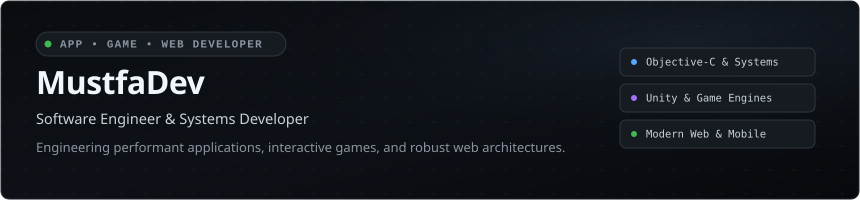

  

  

  
  &nbsp;
  
  &nbsp;
  
  &nbsp;
  

---

### About Me

- **Focus** — Engineering cross-platform applications, games, and modern web architectures with an emphasis on performance, creativity, and clean design.
- **Currently Learning** — Deepening practical expertise in **Lua** and **React**.
- **Specialization** — Inquiries welcome regarding **Objective-C** and native platform development.
- **Interests** — Game development architectures, interactive software systems, and real-time graphics.
- **Scope** — Designing and maintaining digital solutions built for a global audience.
- **Collaboration** — Open to select collaborations, open-source initiatives, and technical discussions.
- **Repositories** — Explore my full portfolio of open projects at [github.com/mustfadev](https://github.com/mustfadev).
- **Contact** — Reach me directly at [mustfa@info.me](mailto:mustfa@info.me).

---

### Languages & Technologies

#### Languages & Core Systems

  

#### Web Development & Frameworks

  

#### Mobile & Game Development

  

#### Cloud, Databases & Infrastructure

  

#### Design & Prototyping

  

---

### GitHub Statistics

  
  

  

---

### GitHub Trophies

  

---

  Building things that matter • Engineered with precision

